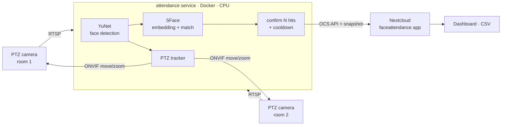

# Face Recognition Attendance System — PTZ cameras + AI + Nextcloud

[](LICENSE)


**Open-source employee attendance system based on face recognition.** Ordinary IP / Wi-Fi PTZ cameras
watch the office, the AI **turns and zooms the camera toward faces (ONVIF PTZ auto-tracking)**,
recognises people from a distance and writes **who arrived, when, and in which room** to
**Nextcloud** through a dedicated Nextcloud app with a dashboard.

> 🇺🇿 O'zbek tilida: [README.uz.md](README.uz.md)

- ✅ **No GPU, no cloud**: runs on a small CPU server, and faces never leave your network
- ✅ **Commercial-friendly models**: YuNet (MIT) and SFace (Apache-2.0) from the OpenCV Model Zoo
- ✅ **No training**: add 5–10 photos of a person to a folder and you're done
- ✅ **PTZ auto-tracking**: centres and zooms onto unidentified faces, then returns to the door
- ✅ **Any ONVIF / RTSP camera**, including cheap Wi-Fi PTZ cameras
- ✅ **Nextcloud app**: daily summary (arrived / last seen / late / absent), all events, stranger alerts with snapshots, CSV export, automatic data retention
- ✅ **Reliable**: multi-frame confirmation, per-person cooldown, disk spool when Nextcloud is offline

## How it works



1. **Detect.** Each camera frame (2–3 fps, only when something moves) goes through **YuNet**.
2. **Recognise.** Every face is aligned and turned into a 128-d **SFace** embedding, then compared (cosine similarity) with the gallery built from your photos.
3. **Confirm.** A person must match **3 times within 4 s** before an event is written. A stranger needs 6 hits.
4. **Track.** On PTZ cameras the tracker sends short ONVIF pulses to centre the biggest *not yet identified* face and zooms in until it is ~120 px wide. After 20 s without faces the camera returns to its home preset (point it at the door).
5. **Log.** The event (name, room, camera, score, face snapshot) is POSTed to the Nextcloud app. The same person is logged at most once per room every 10 min. First sighting = arrival, last sighting = departure.

## 24/7 on a tiny CPU budget

Running a neural network on every frame all day is wasteful. The service uses a **cascade**
so the expensive parts run only when something actually changes:

| Stage | Runs when | Cost |
|---|---|---|
| Sub-stream (640×360) decode + motion check | always | very low |
| Main stream decode | **keyframes only** while idle, every frame on motion | low → medium |
| Face detection (YuNet) | motion, 3 fps; 1 fps at 640 px when "calm" | medium |
| Face embedding (SFace) | new / unverified faces only; known faces are **tracked** and re-checked every 5 s | low |
| Everything | outside `ACTIVE_HOURS` / `ACTIVE_DAYS` the cameras are disconnected | **0** |

Measured on a 3-vCPU VPS, one 720p camera (percent of one core):

| Situation | CPU |
|---|---|
| Empty room | **~2–3 %** |
| Someone walks in (a few seconds) | 60–80 % |
| People sitting in view all day (already logged) | **~6–10 %** |
| Outside working hours | **0 %** |

"Calm" = everyone in view is identified and already logged. A newcomer breaks calm within
one keyframe interval and the full pipeline takes over.

## Requirements

| | |
|---|---|
| Server | Any x86_64/ARM64 Linux with Docker. 2 cameras ≈ 1–1.5 CPU cores at 3 fps |
| Cameras | RTSP stream (required) + ONVIF PTZ (optional, for tracking) |
| Network | The server must reach the cameras' RTSP/ONVIF ports (same LAN, or a VPN such as WireGuard) |
| Nextcloud | 30 – 33 |

## Quick start

```bash
git clone https://github.com/jamolovmn/face-recognition-attendance.git
cd face-recognition-attendance
cp .env.example .env
docker compose build
```

### 1. Find your camera's RTSP URL and PTZ support

```bash
docker compose run --rm attendance python -m attendance.probe 192.168.1.50 --user admin --password secret
docker compose run --rm attendance python -m attendance.probe 192.168.1.50 --user admin --password secret --ptz-test
```

`probe` scans the common ONVIF ports and prints the device info, every stream profile with its RTSP URL (and saves a test frame), PTZ support and presets. Put the results in `.env` (`CAM_<ID>_RTSP`, `CAM_<ID>_ONVIF_PORT`, …).

> Many cheap Wi-Fi cameras have ONVIF **turned off** by default. Enable it in the camera's app or web UI and set an ONVIF password.

### 2. Enroll people

```
faces/
  Ali Valiyev/        1.jpg 2.jpg 3.jpg ...
  Dilnoza Karimova/   1.jpg 2.jpg ...
```

```bash
docker compose run --rm attendance python -m attendance.enroll
```

Use 5–10 photos per person with different angles, lighting and glasses. The folder name is the name shown in Nextcloud. The running service reloads the gallery automatically within a minute.

### 3. Install the Nextcloud app

```bash
cp -r nextcloud-app/faceattendance /path/to/nextcloud/custom_apps/
chown -R www-data:www-data /path/to/nextcloud/custom_apps/faceattendance
sudo -u www-data php occ app:enable faceattendance

# a service account for the cameras
sudo -u www-data php occ group:add attendance
OC_PASS='long-random-password' sudo -E -u www-data php occ user:add --password-from-env --group attendance attendance-bot
sudo -u www-data php occ user:auth-tokens:add attendance-bot   # -> NC_APP_PASSWORD
```

Only **admins** and members of the **`attendance`** group can open the dashboard or post events.
Add HR / managers to that group.

### 4. Run

```bash
docker compose up -d
docker compose logs -f
```

### No VPN / no public IP? Use an old Android phone

If the office is behind NAT you can't open (ISP modem, CGNAT) and the router's VPN client
doesn't allow inbound traffic, any always-on device inside the office can **dial out** to the
server and carry the camera ports through an SSH reverse tunnel. An old Android phone with
[Termux](https://f-droid.org/packages/com.termux/) is enough:

```bash
# on the phone (Termux), one line per camera port
ssh -N -o ServerAliveInterval=20 -o ExitOnForwardFailure=yes \
  -R 127.0.0.1:11554:192.168.1.232:554 -R 127.0.0.1:11899:192.168.1.232:8899 \
  camtunnel@your-server
```

On the server create a dedicated user that may **only** open those forwards
(`AllowTcpForwarding remote`, `PermitListen 127.0.0.1:11554 ...`, `ForceCommand nologin`,
key with `restrict,port-forwarding`). Then point `.env` at `127.0.0.1:<port>`. The ONVIF
client rewrites the camera's LAN service addresses to the tunnel address automatically, and
`probe --rtsp-port` does the same for RTSP. Install
[Termux:Boot](https://f-droid.org/packages/com.termux.boot/) so the tunnel starts after a reboot.

### Run on an office Windows PC (no Docker), with automatic failover

Running the AI inside the office is often the better setup: video never leaves the LAN, no tunnel or port forwarding is needed, and only small events go out to Nextcloud over HTTPS.

1. Copy the project to `C:\FaceAttendance` (no spaces in the path) and fill in `.env` with the cameras' LAN addresses.
2. In PowerShell **as Administrator**:
   ```powershell
   cd C:\FaceAttendance
   powershell -ExecutionPolicy Bypass -File windows\install.ps1
   ```
   It installs Python 3.12 (via winget) and the libraries, downloads the models, disables sleep on AC power and registers a `FaceAttendance` scheduled task that starts at boot without anyone logging in and restarts the service if it stops. Log: `data\attendance.log`.
3. Probe and enroll the same way as with Docker, using `.venv\Scripts\python.exe -m attendance.probe ...` and `-m attendance.enroll`.

**Two always-on PCs, one active.** Install on both, set `FAILOVER=true`, and give the main PC `NODE_PRIORITY=1` and the backup `NODE_PRIORITY=2`. Every node sends a heartbeat to the Nextcloud app every ~15 s and only the lease holder connects to the cameras. The standby node uses no camera bandwidth and almost no CPU. If the main PC goes silent for `LEASE_TTL_SEC` (45 s), the backup takes over. When the main PC comes back, it takes over again. If both run for a moment during a handover, Nextcloud drops the duplicate arrivals itself (same person, same room, within 2 minutes). Both PCs need the same `faces/` folder; run `enroll` on each.

## Configuration

Everything is set through `.env`. [`.env.example`](.env.example) documents every variable. The most important ones:

| Variable | Default | Meaning |
|---|---|---|
| `CAMERAS` | – | Camera ids, e.g. `room1,room2` |
| `CAM_<ID>_RTSP` | – | RTSP URL (use the **main** stream for distance) |
| `CAM_<ID>_ROOM` | id | Room name shown in Nextcloud |
| `CAM_<ID>_PTZ` | `false` | Enable ONVIF auto-tracking |
| `CAM_<ID>_ONVIF_HOST/PORT/USER/PASS` | – | ONVIF access |
| `CAM_<ID>_HOME_PRESET` | – | Preset to return to when idle (ONVIF home if empty) |
| `MATCH_THRESHOLD` | `0.40` | Cosine similarity for a match (OpenCV reference: 0.363) |
| `CONFIRM_HITS` / `CONFIRM_WINDOW_SEC` | `3` / `4` | Hits needed before logging |
| `COOLDOWN_MIN` | `10` | Minimum minutes between two events of one person in one room |
| `PROCESS_FPS` | `3` | Analysed frames per second per camera |
| `UNKNOWN_EVENTS` | `true` | Log strangers with a snapshot |
| `NC_URL`, `NC_USER`, `NC_APP_PASSWORD` | – | Nextcloud connection |

Nextcloud side: `occ config:app:set faceattendance retention_days --value 90 --type integer` controls how long events and snapshots are kept (`0` = forever).

## Nextcloud API

```
POST /ocs/v2.php/apps/faceattendance/api/v1/events      (OCS-APIRequest: true, basic auth)
{ "uid": "...", "person": "Ali Valiyev" | null, "camera": "room1", "room": "Office 1",
  "score": 0.71, "ts": 1790246135, "snapshot": "<base64 jpeg>" }

GET  /ocs/v2.php/apps/faceattendance/api/v1/events?from=<unix>&to=<unix>[&person=][&room=]

POST /ocs/v2.php/apps/faceattendance/api/v1/lease       (failover heartbeat)
{ "node": "office-pc-1", "priority": 1, "ttl": 45 }  ->  { "leader": true, "holder": "office-pc-1", "until": ... }
```

`uid` makes the POST idempotent, so retries never create duplicates. The same person in the same room within 2 minutes is also stored only once. `person=` (empty) returns only strangers.

## Tips for accuracy

- A face needs to be **≥ 80–110 px wide** in the frame. Optical zoom (PTZ) or a camera close to the door helps more than anything else.
- Mount the camera at head height, facing the entrance, and avoid strong backlight from windows.
- Too many false matches → raise `MATCH_THRESHOLD` (0.45). Known people shown as unknown → add more photos, or lower it slightly.
- A PTZ camera zoomed on one person does not see the rest of the room. For strict attendance, a fixed camera at the door plus PTZ for the room works best.

## Privacy & law

Face templates are **biometric personal data**. Get written consent from employees, tell them where cameras are, keep the data on your own server (this project never sends it anywhere else) and set a retention period. The `faces/` folder and `data/` are git-ignored, so never commit them.

## Project layout

```
attendance/            Python service
  main.py              camera workers, confirmation, cooldown
  faces.py             YuNet + SFace (OpenCV)
  ptz.py / onvif.py    PTZ auto-tracking, dependency-free ONVIF client
  sink.py              Nextcloud client with offline spool
  lease.py             active/standby failover between nodes
  enroll.py / probe.py CLI tools
nextcloud-app/faceattendance/   Nextcloud app (PHP, vanilla JS, no build step)
windows/               Windows installer (scheduled task, no Docker)
```

## License

[MIT](LICENSE). Models: YuNet (MIT), SFace (Apache-2.0) from the [OpenCV Model Zoo](https://github.com/opencv/opencv_zoo).

**Keywords:** face recognition attendance system, employee attendance, time tracking, facial recognition, PTZ camera auto tracking, ONVIF, RTSP, IP camera, Nextcloud app, OpenCV, YuNet, SFace, Python, Docker, self-hosted, open source
